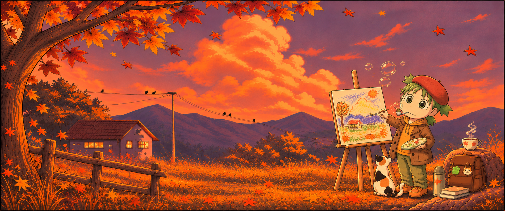
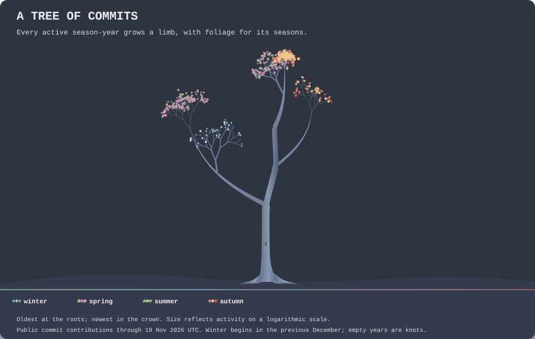

  

🍂 &nbsp; 🍁 &nbsp; 🍂

---

## 🍂 About Me

- 🔭 Open to opportunities
- 🍁 Did **Google Summer of Code 2026** with **[KDE](https://invent.kde.org/anshs-lab)** and am now organising **Season of KDE 2027**
- 🌱 Learning C++ DSA, Linux scripting and scalable backend systems
- 👯 Open to collaborating on open source, hackathons and anything web or game dev
- 💬 Ask me about game dev, hackathon planning, or getting started with C++
- ⚡ Fun fact: I once broke my entire Linux system just to reinstall it for fun. Twice. 😆

---

## 🍁 Tech Stack

**Languages**

**Web and Data**

**Design**

---

## 🌰 Open Source Contribution

🍁 **Google Summer of Code 2026 with KDE:** built **[join.kde.org](https://join.kde.org)** from scratch as the onboarding and entry point into the KDE contributor environment.

🍂 **Season of KDE 2027:** currently organising it. [Learn more](https://mentorship.kde.org/sok/)

  

---

## 🌿 The Garden

A **tree of commits**, grown from my public commit contributions across GitHub.
Each active season-year grows a limb, with the oldest at the roots and the newest in the crown.
Its foliage follows the seasons, and years without public commits leave knots. It refreshes nightly.

  <picture>
    <source media="(prefers-color-scheme: dark)" srcset="https://raw.githubusercontent.com/AnshsLab/AnshsLab/main/assets/garden/garden-dark.svg?v=cca106c21f96d0f0">
    <source media="(prefers-color-scheme: light)" srcset="https://raw.githubusercontent.com/AnshsLab/AnshsLab/main/assets/garden/garden-light.svg?v=235a65704a71c131">
    
  </picture>

---

## 📊 GitHub Stats

  

---

  

🍂 &nbsp; 🍁 &nbsp; 🍂
